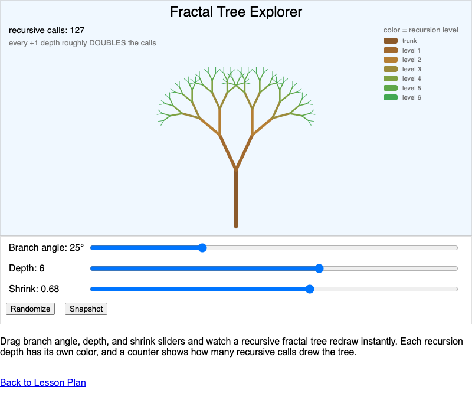

# Elenco delle MicroSim di Introduzione a Python

Micro Simulazioni interattive per aiutare gli studenti che iniziano a programmare in Python. Clicca su una card per aprire il MicroSim.

-   **[Esecutore di Codice Passo-Passo](./code-stepper/index.md)**

    ---

    

    Percorri un breve programma Python una riga alla volta e guarda
    l'output apparire — vedi l'esecuzione dall'alto verso il basso con i
    tuoi stessi occhi. (Capitoli 1-2)

-   **[Modello di Memoria delle Variabili](./variable-memory-model/index.md)**

    ---

    

    Guarda scatole di memoria etichettate venire create, lette e
    sostituite mentre uno script viene eseguito — la metafora del
    post-it resa reale. (Capitolo 3)

-   **[Flusso di Chiamata delle Funzioni](./function-call-flow/index.md)**

    ---

    

    Traccia una chiamata di funzione al rallentatore: l'argomento vola
    nello slot del parametro e il valore di ritorno vola indietro.
    (Capitolo 4)

-   **[Ispettore dello Stato della Turtle](./turtle-state-inspector/index.md)**

    ---

    

    Percorri i comandi della turtle mentre un pannello rivela lo stato
    nascosto della turtle: posizione, bussola della direzione e penna.
    (Capitolo 5)

-   **[Valutatore di Espressioni](./expression-evaluator/index.md)**

    ---

    

    Guarda `2 + 3 * 4` ridursi un'operazione alla volta esattamente
    nell'ordine in cui Python la valuta — PEMDAS reso visibile.
    (Capitolo 6)

-   **[Orologio del Modulo](./modulo-clock/index.md)**

    ---

    

    Vedi il resto come un conteggio circolare su un quadrante e come
    puntini rimanenti — l'operatore `%` reso concreto. (Capitolo 6)

-   **[Esecutore Passo-Passo del Ciclo For](./for-loop-stepper/index.md)**

    ---

    

    Fai girare a mano un ciclo for: guarda `i` cambiare, la freccia
    saltare indietro in cima, e una turtle disegnare un lato del
    quadrato per ogni giro. (Capitolo 7)

-   **[Esploratore di Range](./range-explorer/index.md)**

    ---

    

    Scorri inizio, fine e passo e guarda la linea dei numeri
    illuminarsi — il valore finale è un anello vuoto perché non è mai
    incluso. (Capitolo 7)

-   **[Esploratore del Flusso di Controllo](./control-flow-explorer/index.md)**

    ---

    

    Sposta uno slider del punteggio e guarda esattamente un percorso
    attraverso un diagramma di flusso if/elif/else illuminarsi di verde
    — i controlli successivi non vengono nemmeno guardati. (Capitolo 9)

-   **[Laboratorio di Logica Booleana](./boolean-logic-lab/index.md)**

    ---

    

    Collega input True/False in and, or e not — e cogli Python mentre
    salta il secondo input quando il primo decide già. (Capitoli 9, 19)

-   **[Esecutore Passo-Passo del Ciclo While](./while-loop-stepper/index.md)**

    ---

    

    Senti il ritmo controlla-esegui-controlla di un ciclo while — e
    guarda in sicurezza un ciclo infinito girare dentro la sua gabbia.
    (Capitolo 10)

-   **[Ispettore degli Ambiti](./scope-inspector/index.md)**

    ---

    

    Le variabili vivono in stanze: guarda una stanza Funzione apparire
    durante una chiamata, oscurare quella globale, e svanire al ritorno.
    (Capitolo 11)

-   **[Miscelatore di Colori RGB](./rgb-color-mixer/index.md)**

    ---

    

    Mescola rosso, verde e blu, guarda il codice esadecimale
    assemblarsi da solo, e copia la riga pencolor direttamente nella
    tua arte con la turtle. (Capitolo 12)

-   **[Affettatore di Stringhe](./string-slicer/index.md)**

    ---

    

    Trascina le maniglie di inizio e fine sopra le tessere delle
    lettere e guarda `word[2:7]` costruirsi da solo — la fine non è mai
    inclusa, e ora puoi vedere perché. (Capitoli 8, 14)

-   **[Esploratore degli Indici di Lista](./list-index-explorer/index.md)**

    ---

    

    Aggiungi, inserisci ed estrai da una lista di scatole colorate e
    guarda ogni indice rinumerarsi — più il TypeError che dà una
    stringa invece. (Capitoli 15-16)

-   **[Simulatore di Pila e Coda](./stack-queue-simulator/index.md)**

    ---

    

    Dai in pasto le stesse lettere a una pila di piatti e a una fila
    d'attesa — poi guardale uscire in ordini opposti. (Capitoli 16, 30)

-   **[Istogramma dei Lanci di Dadi](./dice-roll-histogram/index.md)**

    ---

    

    Lancia 1, 100 o 1000 dadi e guarda il caos appiattirsi in un
    pattern — poi trova la montagna nascosta nelle somme di due dadi.
    (Capitolo 17)

-   **[Esploratore dell'Onda Sinusoidale](./sine-wave-explorer/index.md)**

    ---

    

    Trascina gli slider di ampiezza, frequenza e fase e guarda
    `y = A × sin(f·x + p)` ridisegnarsi istantaneamente. (Capitolo 18)

-   **[Cerchio Unitario — Gradi e Radianti](./unit-circle-radians/index.md)**

    ---

    

    Trascina un punto intorno al cerchio unitario e leggi l'angolo in
    gradi, radianti e multipli di π — con barre di seno e coseno.
    (Capitolo 18)

-   **[Diagramma di Venn delle Operazioni sugli Insiemi](./set-operations-venn/index.md)**

    ---

    

    Digita due insiemi, guarda i gettoni atterrare nelle regioni
    giuste, e illumina unione, intersezione e differenza. (Capitolo 20)

-   **[Ricerca delle Chiavi nel Dizionario](./dictionary-key-lookup/index.md)**

    ---

    

    Digita una chiave e il cassetto giusto scatta aperto in un solo
    balzo — o incontri un KeyError — poi fai gareggiare il dizionario
    contro una lista. (Capitolo 21)

-   **[Pila delle Chiamate Ricorsive](./recursion-call-stack/index.md)**

    ---

    

    Guarda i frame di factorial(4) impilarsi fino al caso base dorato,
    poi srotolarsi mentre ogni moltiplicazione in sospeso si riempie.
    (Capitoli 23-24)

-   **[Esploratore dell'Albero Frattale](./fractal-tree-explorer/index.md)**

    ---

    

    Scolpisci un albero ricorsivo con slider di angolo, profondità e
    restringimento — ogni livello di ricorsione indossa il proprio
    colore. (Capitolo 24)

-   **[Ispettore delle Istanze degli Oggetti](./object-instance-inspector/index.md)**

    ---

    

    Un progetto tratteggiato, card di istanza solide, e una freccia
    luminosa che mostra esattamente quale cane è `self`. (Capitolo 25)

-   **[Esploratore dell'Ereditarietà](./inheritance-explorer/index.md)**

    ---

    

    Clicca una chiamata a un metodo e guarda la ricerca risalire
    l'albero delle classi — gli override oscurano il genitore, e
    super() risale di proposito. (Capitolo 25)

-   **[Mappatore dei Tipi da JSON a Python](./json-python-mapper/index.md)**

    ---

    

    Modifica il JSON a sinistra e guarda gli oggetti Python apparire a
    destra — true diventa True, null diventa None. (Capitolo 27)

-   **[Laboratorio di Corrispondenze Regex](./regex-match-lab/index.md)**

    ---

    

    Digita un pattern, guarda le corrispondenze illuminarsi dal vivo, e
    leggi il pattern come gettoni in inglese semplice — il regex smette
    di essere magia. (Capitolo 29)

-   **[Comparatore di Algoritmi di Ordinamento](./sorting-comparer/index.md)**

    ---

    

    Percorri tre ordinamenti classici un confronto alla volta, poi fai
    gareggiare bubble contro insertion sugli stessi dati — il vincitore
    dipende dai dati. (Capitolo 30)

-   **[Gara di Ricerca](./search-race/index.md)**

    ---

    

    La ricerca lineare avanza faticosamente scatola per scatola mentre
    la ricerca binaria butta via metà scaffale a ogni controllo — e una
    trappola con lo scaffale mescolato mostra perché ordinato conta.
    (Capitolo 30)

-   **[Esploratore di Attraversamento del Grafo](./graph-traversal-explorer/index.md)**

    ---

    

    Percorri BFS e DFS sullo stesso grafo con la coda o la pila dal
    vivo accanto — poi guarda BFS rivelare il percorso più breve.
    (Capitolo 30)

